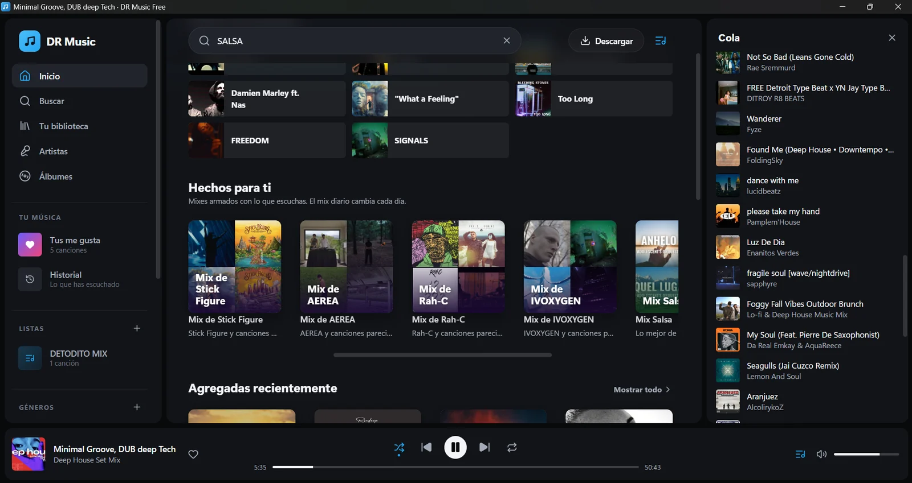
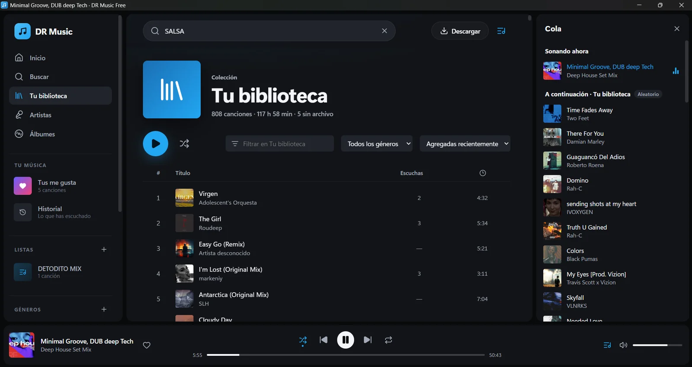
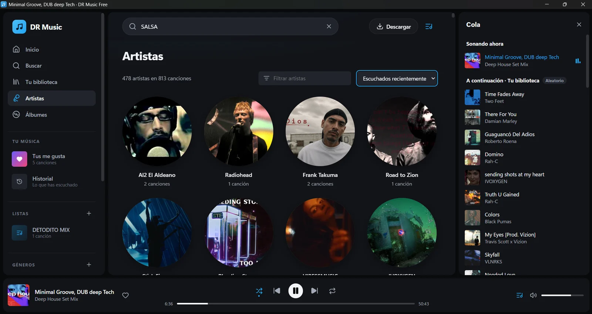
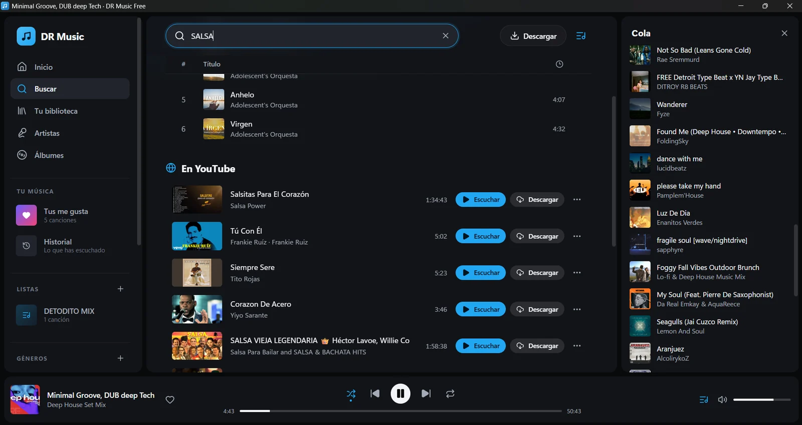
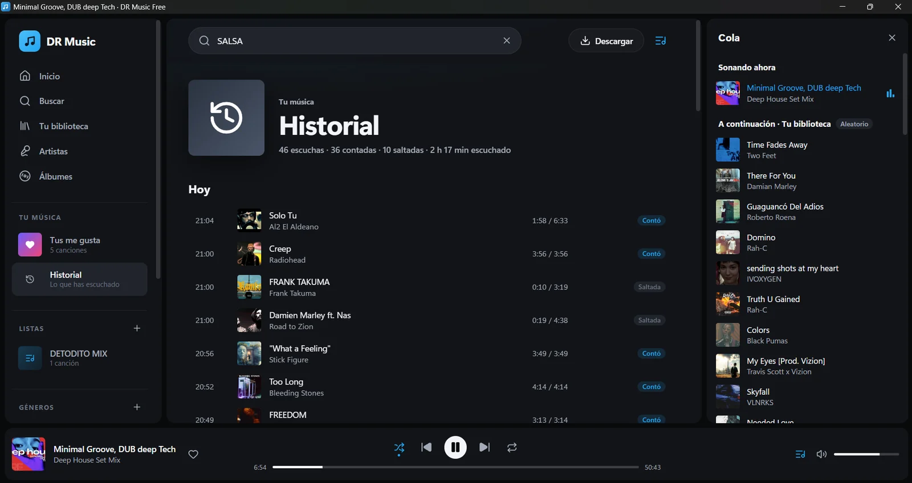
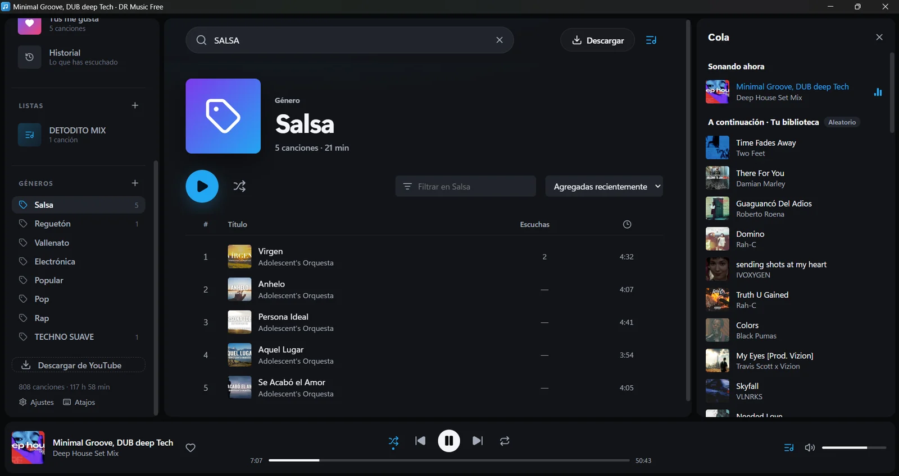

# 🎵 DR Music Free

🌐 [English](README.md) · **Español**

Reproductor de música de escritorio para Windows. Organiza y reproduce tu biblioteca local sin depender de internet, con listas, mixes automáticos según lo que escuchas y, de forma opcional, búsqueda y descarga desde YouTube.


<p align="center">
  
</p>

<table>
  <tr>
    <td></td>
    <td></td>
  </tr>
  <tr>
    <td align="center">Biblioteca</td>
    <td align="center">Artistas</td>
  </tr>
  <tr>
    <td></td>
    <td></td>
  </tr>
  <tr>
    <td align="center">Búsqueda en la biblioteca y en YouTube</td>
    <td align="center">Historial de escuchas</td>
  </tr>
  <tr>
    <td></td>
    <td></td>
  </tr>
  <tr>
    <td align="center">Géneros</td>
    <td></td>
  </tr>
</table>

---

## ⚠️ Aviso legal

**Esta herramienta es para fines EDUCATIVOS y USO PERSONAL.**

- El usuario es el único responsable del uso que le dé
- No fomentamos la piratería
- No descargues contenido con derechos de autor sin permiso
- Las letras vienen de [LRCLIB](https://lrclib.net) y son de sus autores; solo se muestran para uso personal

---

## ✨ Funciones

- **Biblioteca local** guardada en SQLite, sin servidor de base de datos.
- **Listas de reproducción** y **géneros**.
- **Páginas de artistas y álbumes**. Las colaboraciones ("Feid, El Americano") enlazan a cada artista.
- **Mixes automáticos según el historial**:
  - mix diario;
  - más escuchadas de siempre y del último mes;
  - mix por artista y por género;
  - "hace rato no escuchas";
  - recién agregadas.
- **Cola de reproducción** con aleatorio y repetición.
- **Favoritas** e **historial de escuchas**.
- **Atajos de teclado** y **teclas multimedia** del teclado y de Windows.
- **Bandeja del sistema**: la app puede seguir sonando con la ventana cerrada.
- **Carátulas sin conexión**: se guardan en disco a partir de la carátula del archivo o de la miniatura del video.
- **Importación de carpetas** del equipo. Los archivos se leen donde están, nunca se mueven ni se borran.
- **Corrección automática de artistas** para canciones sin artista, con artista y título invertidos o con el mismo artista escrito de varias formas. Primero se proponen los cambios y no se aplica nada hasta que el usuario los revisa.
- **Búsqueda y descarga opcional desde YouTube**: reproducción en línea o descarga a MP3 con metadatos.
- **Letras** desde [LRCLIB](https://lrclib.net) (gratis, sin clave), ocultas hasta que las abres. La letra sincronizada resalta la línea actual, se desplaza sola y salta a un momento con un clic; la letra sin sincronizar muestra el texto completo. Se guardan en disco y funcionan sin internet y con canciones en línea de YouTube. Atajo: `T`.
- **Modo karaoke**: pantalla completa con la letra grande y centrada, la línea actual resaltada y la siguiente en gris, legible de lejos en un televisor. Atajo: `K`; se sale con `Esc`.
- **Fondo personalizado**: una imagen propia (JPG, PNG o WEBP) o la carátula de la canción actual detrás de toda la app, oscurecida y difuminada, con controles de intensidad y difuminado y, si quieres, el color de acento tomado de la imagen. El difuminado se calcula una vez y se guarda, así que no cuesta nada al desplazarse.
- **Pantalla de bienvenida** la primera vez: tu nombre para el saludo y la carpeta de música (recomendada: `Música\DR Music Free`).

---

## 🛠️ Stack tecnológico

| Capa | Tecnologías |
|------|-------------|
| **Escritorio** | Electron |
| **Interfaz** | React, Vite |
| **Servidor** | Python, FastAPI, SQLAlchemy, SQLite |
| **Audio** | FFmpeg, yt-dlp |
| **Empaquetado** | PyInstaller (servidor), electron-builder (instalador NSIS) |

---

## 🧩 Arquitectura

```
Electron (proceso principal)
 ├─ 1. busca un puerto libre y lanza ──► Servidor Python (FastAPI)
 │                                         ├─ SQLite (biblioteca, historial, listas)
 │                                         ├─ carpeta de música y carpetas importadas
 │                                         └─ FFmpeg / yt-dlp
 └─ 2. abre la ventana ──► Interfaz React ◄── HTTP en 127.0.0.1:<puerto> ──► Servidor
```

1. Al arrancar, Electron busca un **puerto libre** en `127.0.0.1` y lanza el servidor Python:
   - en la app instalada, el ejecutable creado con PyInstaller;
   - en desarrollo, `backend/venv`.
2. Espera a que el servidor responda y abre la ventana. La interfaz React recibe el puerto y habla con la API por HTTP local.
3. El servidor gestiona la biblioteca (SQLite), sirve el audio con soporte de rangos, guarda las carátulas, calcula los mixes y se encarga de las descargas.
4. Al cerrar la app, Electron detiene el servidor.

Los datos viven en `%APPDATA%\DR Music Free`: base de datos, ajustes, carátulas, letras, fondo personalizado y copias de seguridad. Desinstalar la app no los borra, ni tampoco la música.

---

## 🚀 Desarrollo

### Requisitos

- Windows 10 u 11
- Python 3.12+
- Node.js 20+
- FFmpeg (en el `PATH`, o en `desktop/vendor/bin` con `node scripts/build.mjs vendor`)

### 1. Clonar e instalar

```bash
git clone https://github.com/DanielRodriguez9/dr-music-free.git
cd dr-music-free

# servidor
cd backend
python -m venv venv
venv\Scripts\pip install -r requirements-dev.txt
copy .env.example .env      # opcional: todas las variables tienen valor por defecto
cd ..

# interfaz
cd frontend
npm install
cd ..

# escritorio
cd desktop
npm install
cd ..
```

### 2. Ejecutar

**Como app de escritorio**: Electron lanza el servidor por su cuenta.

```bash
cd frontend && npm run build && cd ..
cd desktop && npm start
```

**En el navegador**, con recarga en caliente. Usa dos terminales:

```bash
# terminal 1: servidor en http://127.0.0.1:8000 (documentación en /docs)
cd backend
venv\Scripts\python main.py

# terminal 2: interfaz en http://localhost:5174
cd frontend
npm run dev
```

---

## 🧪 Tests

```bash
# servidor (pytest)
cd backend
venv\Scripts\python -m pytest

# interfaz (Vitest + ESLint)
cd frontend
npm test
npm run lint
```

Los tests del servidor trabajan en carpetas temporales y nunca tocan la música ni la base de datos real.

---

## 📦 Compilar el instalador

```bash
cd desktop
npm run build
```

El script `desktop/scripts/build.mjs` hace todo el proceso:

1. compila la interfaz con Vite;
2. empaqueta el servidor con PyInstaller;
3. prepara FFmpeg y yt-dlp en `desktop/vendor/bin`;
4. genera el instalador con electron-builder.

El resultado queda en `desktop/release/DR-Music-Free-Setup-<versión>.exe`.

Para ejecutar solo algunos pasos: `node scripts/build.mjs frontend backend installer`. Si FFmpeg no está en el `PATH`, indica su carpeta con la variable `FFMPEG_DIR`.

---

## 📁 Estructura del proyecto

```text
dr-music-free/
├── backend/                  Servidor FastAPI
│   ├── main.py               API y arranque
│   ├── config.py             Rutas y opciones (.env / variables de entorno)
│   ├── db.py                 Modelos SQLAlchemy y migraciones de SQLite
│   ├── library.py            Título/artista, etiquetas y archivos de audio
│   ├── downloader.py         Cola de descargas con progreso
│   ├── youtube.py            Búsqueda y reproducción en línea
│   ├── ytdlp_tool.py         yt-dlp actualizable sin reinstalar la app
│   ├── covers.py             Carátulas guardadas en disco
│   ├── lyrics.py             Letras de LRCLIB guardadas en disco
│   ├── appearance.py         Fondo personalizado (copia reducida)
│   ├── mixes.py              Mixes automáticos
│   ├── fixes.py              Propuestas de corrección de artistas
│   ├── importer.py           Importación de carpetas locales
│   ├── tests/                Tests con pytest
│   └── requirements.txt
├── frontend/                 Interfaz React + Vite
│   └── src/
│       ├── pages/            Inicio, Buscar, Artistas, Álbumes, Mix, Historial, Ajustes...
│       ├── components/       Lista de canciones, barra del reproductor, tarjetas...
│       ├── player/           Reproductor, cola y teclas multimedia
│       ├── context/          Estado de la biblioteca y de la interfaz
│       ├── hooks/            Atajos, acciones sobre canciones, mixes...
│       └── lib/              Formato, artistas y vistas (con tests)
├── desktop/                  App de escritorio Electron
│   ├── src/                  Proceso principal, servidor, ajustes y preload
│   ├── scripts/build.mjs     Compilación completa del instalador
│   ├── build/                Icono de la app
│   └── electron-builder.yml  Configuración del instalador NSIS
├── docs/screenshots/         Capturas del README
├── .gitignore
├── PENDIENTES.md             Estado actual e ideas futuras
├── README.md                 Versión en inglés
└── README.es.md              Este archivo (español)
```

---

## 👤 Autor

**Daniel Ricardo Parra** · GitHub: [@DanielRodriguez9](https://github.com/DanielRodriguez9)

## 📄 Licencia

MIT – Uso personal y educativo.

⭐ ¿Te gusta el proyecto? Dale una estrella en GitHub.
