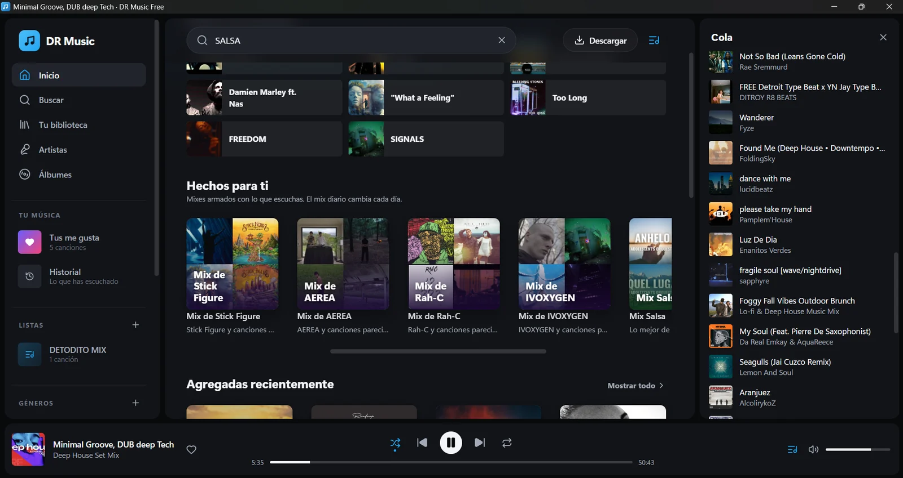
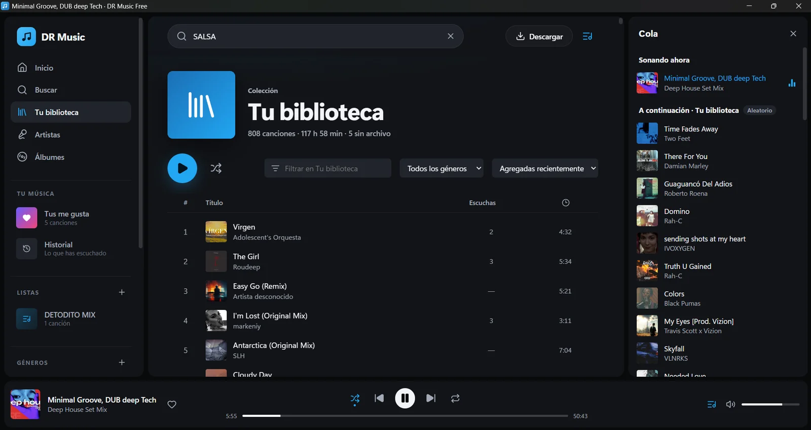
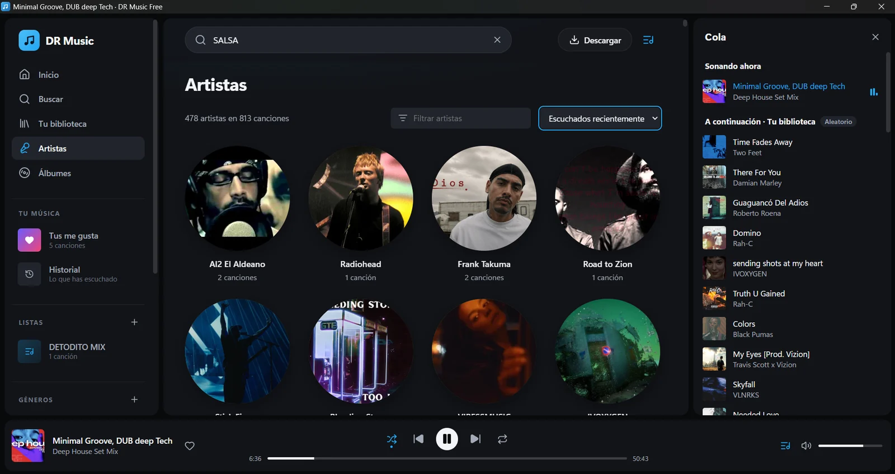
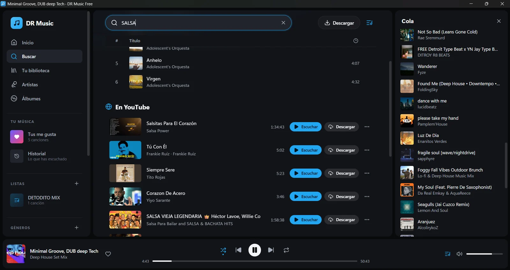
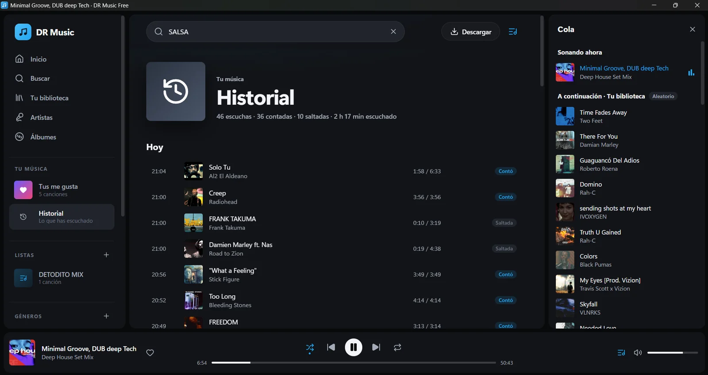
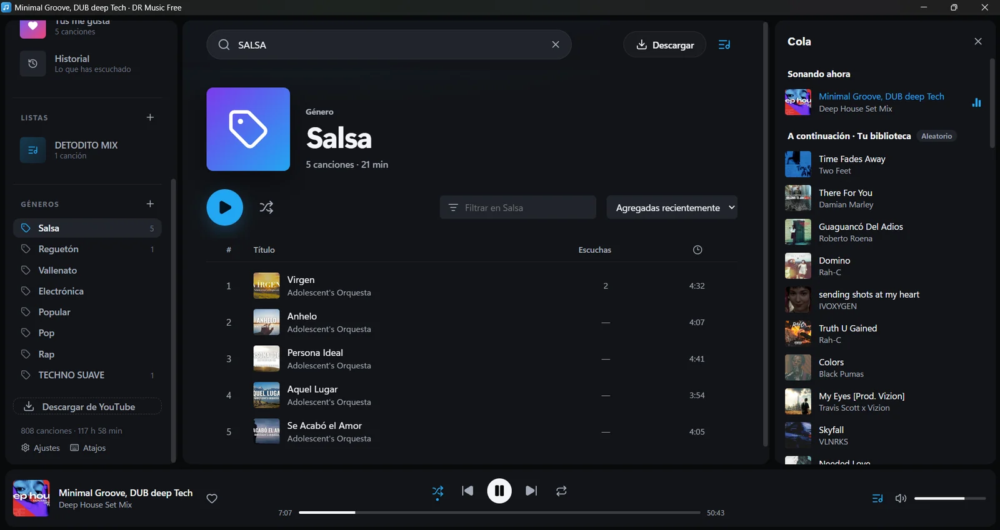

# 🎵 DR Music Free

🌐 **English** · [Español](README.es.md)

Desktop music player for Windows. Organize and play your local library without depending on the internet, with playlists, automatic mixes based on what you listen to and, optionally, search and download from YouTube.

> **Note:** the app's user interface is currently in Spanish.


<p align="center">
  
</p>

<table>
  <tr>
    <td></td>
    <td></td>
  </tr>
  <tr>
    <td align="center">Library</td>
    <td align="center">Artists</td>
  </tr>
  <tr>
    <td></td>
    <td></td>
  </tr>
  <tr>
    <td align="center">Search in the library and on YouTube</td>
    <td align="center">Listening history</td>
  </tr>
  <tr>
    <td></td>
    <td></td>
  </tr>
  <tr>
    <td align="center">Genres</td>
    <td></td>
  </tr>
</table>

---

## ⚠️ Legal notice

**This tool is for EDUCATIONAL purposes and PERSONAL USE only.**

- The user is solely responsible for how it is used
- We do not encourage piracy
- Do not download copyrighted content without permission
- Lyrics come from [LRCLIB](https://lrclib.net) and belong to their authors; they are only shown for personal use

---

## ✨ Features

- **Local library** stored in SQLite, no database server needed.
- **Playlists** and **genres**.
- **Artist and album pages**. Collaborations ("Feid, El Americano") link to each artist.
- **Automatic mixes based on listening history**:
  - daily mix;
  - all-time and last-month most played;
  - per-artist and per-genre mixes;
  - "haven't heard in a while";
  - recently added.
- **Play queue** with shuffle and repeat.
- **Favorites** and **listening history**.
- **Keyboard shortcuts** and **media keys** (keyboard and Windows).
- **System tray**: music can keep playing with the window closed.
- **Offline cover art**: saved to disk from the file's embedded artwork or the video thumbnail.
- **Folder import** from your computer. Files are read where they are; they are never moved or deleted.
- **Automatic artist correction** for songs with no artist, with artist and title swapped, or with the same artist spelled in different ways. Changes are proposed first and nothing is applied until the user reviews them.
- **Optional YouTube search and download**: stream online or download to MP3 with metadata.
- **Lyrics** from [LRCLIB](https://lrclib.net) (free, no API key), hidden until you open them. Synced lyrics highlight the current line, scroll on their own and jump to a moment with a click; plain lyrics show the full text. They are saved to disk and also work offline and with online YouTube songs. Shortcut: `T`.
- **Karaoke mode**: full screen with large centered lyrics, the current line highlighted and the next one in gray, readable from across the room on a TV. Shortcut: `K`, exit with `Esc`.
- **Custom background**: your own image (JPG, PNG or WEBP) or the current song's cover art behind the whole app, darkened and blurred, with intensity and blur controls and an optional accent color taken from the image. The blur is computed once and cached, so it costs nothing while scrolling.
- **Welcome screen** the first time the app opens: your name for the greeting and the music folder (recommended: `Music\DR Music Free`).

---

## 🛠️ Tech stack

| Layer | Technologies |
|------|-------------|
| **Desktop** | Electron |
| **Interface** | React, Vite |
| **Server** | Python, FastAPI, SQLAlchemy, SQLite |
| **Audio** | FFmpeg, yt-dlp |
| **Packaging** | PyInstaller (server), electron-builder (NSIS installer) |

---

## 🧩 Architecture

```
Electron (main process)
 ├─ 1. finds a free port and launches ──► Python server (FastAPI)
 │                                          ├─ SQLite (library, history, playlists)
 │                                          ├─ music folder and imported folders
 │                                          └─ FFmpeg / yt-dlp
 └─ 2. opens the window ──► React interface ◄── HTTP on 127.0.0.1:<port> ──► Server
```

1. On startup, Electron finds a **free port** on `127.0.0.1` and launches the Python server:
   - in the installed app, the executable built with PyInstaller;
   - in development, `backend/venv`.
2. It waits for the server to respond and opens the window. The React interface receives the port and talks to the API over local HTTP.
3. The server manages the library (SQLite), serves audio with range support, stores cover art, builds the mixes and handles downloads.
4. When the app closes, Electron stops the server.

Data lives in `%APPDATA%\DR Music Free`: database, settings, cover art, lyrics, custom background and backups. Uninstalling the app does not delete it, nor the music.

---

## 🚀 Development

### Requirements

- Windows 10 or 11
- Python 3.12+
- Node.js 20+
- FFmpeg (on the `PATH`, or in `desktop/vendor/bin` via `node scripts/build.mjs vendor`)

### 1. Clone and install

```bash
git clone https://github.com/DanielRodriguez9/dr-music-free.git
cd dr-music-free

# server
cd backend
python -m venv venv
venv\Scripts\pip install -r requirements-dev.txt
copy .env.example .env      # optional: every variable has a default value
cd ..

# interface
cd frontend
npm install
cd ..

# desktop
cd desktop
npm install
cd ..
```

### 2. Run

**As a desktop app**: Electron launches the server by itself.

```bash
cd frontend && npm run build && cd ..
cd desktop && npm start
```

**In the browser**, with hot reload. Use two terminals:

```bash
# terminal 1: server at http://127.0.0.1:8000 (API docs at /docs)
cd backend
venv\Scripts\python main.py

# terminal 2: interface at http://localhost:5174
cd frontend
npm run dev
```

---

## 🧪 Tests

```bash
# server (pytest)
cd backend
venv\Scripts\python -m pytest

# interface (Vitest + ESLint)
cd frontend
npm test
npm run lint
```

The server tests work in temporary folders and never touch your real music or database.

---

## 📦 Building the installer

```bash
cd desktop
npm run build
```

The `desktop/scripts/build.mjs` script runs the whole process:

1. builds the interface with Vite;
2. packages the server with PyInstaller;
3. prepares FFmpeg and yt-dlp in `desktop/vendor/bin`;
4. creates the installer with electron-builder.

The output is `desktop/release/DR-Music-Free-Setup-<version>.exe`.

To run only some steps: `node scripts/build.mjs frontend backend installer`. If FFmpeg is not on the `PATH`, set its folder with the `FFMPEG_DIR` variable.

---

## 📁 Project structure

```text
dr-music-free/
├── backend/                  FastAPI server
│   ├── main.py               API and startup
│   ├── config.py             Paths and options (.env / environment variables)
│   ├── db.py                 SQLAlchemy models and SQLite migrations
│   ├── library.py            Title/artist, tags and audio files
│   ├── downloader.py         Download queue with progress
│   ├── youtube.py            Online search and streaming
│   ├── ytdlp_tool.py         yt-dlp, updatable without reinstalling the app
│   ├── covers.py             Cover art saved to disk
│   ├── lyrics.py             Lyrics from LRCLIB, saved to disk
│   ├── appearance.py         Custom background (resized copy)
│   ├── mixes.py              Automatic mixes
│   ├── fixes.py              Artist correction proposals
│   ├── importer.py           Local folder import
│   ├── tests/                pytest tests
│   └── requirements.txt
├── frontend/                 React + Vite interface
│   └── src/
│       ├── pages/            Home, Search, Artists, Albums, Mix, History, Settings...
│       ├── components/       Track list, player bar, cards...
│       ├── player/           Player, queue and media keys
│       ├── context/          Library and interface state
│       ├── hooks/            Shortcuts, song actions, mixes...
│       └── lib/              Formatting, artists and views (with tests)
├── desktop/                  Electron desktop app
│   ├── src/                  Main process, server launcher, settings and preload
│   ├── scripts/build.mjs     Full installer build
│   ├── build/                App icon
│   └── electron-builder.yml  NSIS installer configuration
├── docs/screenshots/         README screenshots
├── .gitignore
├── PENDIENTES.md             Status and roadmap (Spanish)
├── README.md                 This file (English)
└── README.es.md              Spanish version
```

---

## 👤 Author

**Daniel Ricardo Parra** · GitHub: [@DanielRodriguez9](https://github.com/DanielRodriguez9)

## 📄 License

MIT – Personal and educational use.

⭐ Like the project? Give it a star on GitHub.
